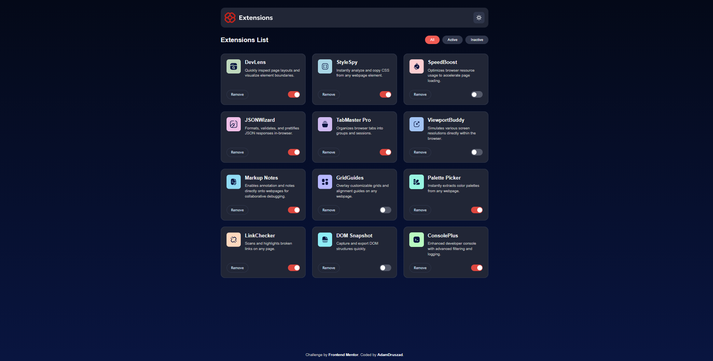

# Frontend Mentor - Browser extensions manager UI solution

This is my solution to the [Browser extensions manager UI challenge on Frontend Mentor](https://www.frontendmentor.io/challenges/browser-extension-manager-ui-yNZnOfsMAp).

## Table of contents

- [Overview](#overview)
  - [The challenge](#the-challenge)
  - [Screenshot](#screenshot)
  - [Links](#links)
- [My process](#my-process)
  - [Built with](#built-with)
  - [What I learned](#what-i-learned)
  - [Continued development](#continued-development)
  - [AI Collaboration](#ai-collaboration)
- [Author](#author)

## Overview

### The challenge

Users should be able to:

- Toggle extensions between active and inactive states
- Filter active and inactive extensions
- Remove extensions from the list
- Select their color theme (Dark/Light mode)
- View the optimal layout depending on their device's screen size

### Screenshot



### Links

- Solution URL: https://github.com/AdamDruszad/BrowserExtensionManager
- Live Site URL: https://adamdruszad.github.io/BrowserExtensionManager/

## My process

### Built with

- Semantic HTML5 markup
- CSS custom properties (Variables)
- Flexbox & CSS Grid
- Mobile-first workflow
- Vanilla JavaScript (Fetch API & DOM manipulation)

### What I learned

During this project, I improved my skills in handling asynchronous data and dynamic UI updates. One of the highlights was implementing a robust "Remove" functionality using event delegation:

```js
grid.addEventListener("click", (event) => {
  if (event.target.classList.contains("remove-btn")) {
    let nameToDelete = event.target.dataset.name;
    event.target.closest(".card").remove();
    allData = allData.filter((item) => item.name !== nameToDelete);
  }
});

I also learned how to manage global state (the allData array) to ensure that filtering and theme switching work seamlessly together even after items are removed.
Continued development

I want to continue improving my web development skills, especially JavaScript. As a Computer Science student, I'm focusing on writing cleaner, more efficient code and understanding complex DOM manipulations.
AI Collaboration

I worked with Gemini 3 Flash as a pair programmer during this project:

    Debugging: AI helped me identify issues with CSS variable scope during the theme switch implementation.

    Refactoring: We worked together to transition from Hungarian variable names to professional English naming conventions.

    Problem Solving: AI introduced me to the concept of event delegation, which made the "Remove" button logic much cleaner.

Author

    Frontend Mentor - @AdamDruszad
```
